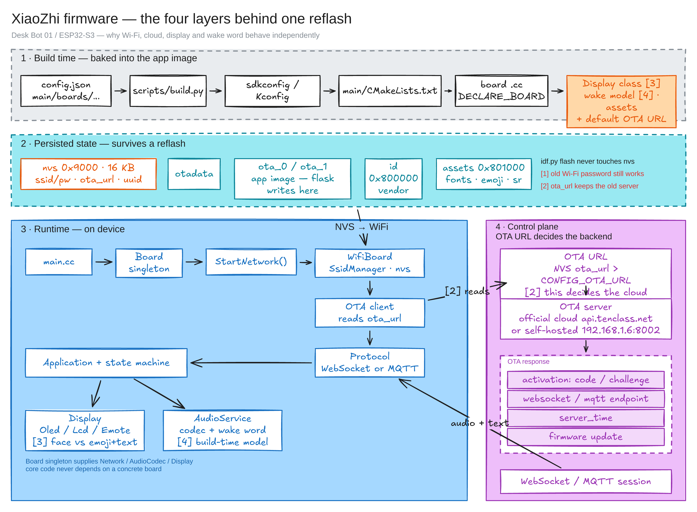

# Firmware Framework Layers

**Last verified:** 2026-11-10

Why one reflash keeps the old Wi-Fi password, still reaches the XiaoZhi cloud,
shows emoji + transcript instead of an animated face, and still accepts a
different wake word. Each answer belongs to a different layer.

The firmware is best understood as a **generic agent shell** whose behavior is
assembled from four independent layers:



Editable scene: [framework-layers.excalidraw](framework-layers.excalidraw)

```
┌─ 4. Control plane ── OTA URL ──> {activation, websocket/mqtt URL, firmware}
├─ 3. Runtime app ───── Board singleton → Application/state machine → audio/display
├─ 2. Persisted state ─ NVS: Wi-Fi creds, ota_url, uuid, ws/mqtt endpoints
└─ 1. Build time ─────── config.json → build.py → sdkconfig/Kconfig → CMake → board .cc
```

## Layer 1 — Build time: which code and data go into the image

The board selection chain starts at `main/boards/desk-bot-01/config.json`:

```json
"target": "esp32s3",
"sdkconfig_append": [
  "CONFIG_BOARD_TYPE_DESK_BOT_01=y",
  "CONFIG_OLED_SSD1306_128X64=y",
  "CONFIG_PARTITION_TABLE_CUSTOM_FILENAME=.../partitions.csv",
  "CONFIG_OTA_URL=\"http://192.168.1.6:8002/xiaozhi/ota/\"",
  ...
]
```

`scripts/build.py` turns that into an `sdkconfig`; `main/CMakeLists.txt` uses
the resulting `CONFIG_BOARD_TYPE_*` to compile **one** board directory, and
`DECLARE_BOARD(...)` in that directory's `.cc` is the only board factory linked.

Decided here and **not changeable at runtime**:

- chip target, pins, display controller, audio codec
- which `Display` subclass is constructed
- wake-word implementation and model
- default OTA URL
- which assets are flashed (fonts / emoji / expressions / `srmodels.bin`)

The board's `config.json` pins the self-hosted OTA URL — but only as a
*default* (see Layer 4).

## Layer 2 — Persisted state: what survives a reflash

`main/boards/desk-bot-01/partitions.csv`:

| Region | Offset | Contents |
|---|---|---|
| `nvs` | `0x9000` | Wi-Fi SSIDs/passwords, `ota_url`, device UUID, MQTT/WS endpoints |
| `otadata` + `ota_0`/`ota_1` | `0xd000`… | app images (A/B) |
| `id` | `0x800000` | vendor identity data (not read by this firmware) |
| `assets` | `0x801000` | fonts, emoji, emote expressions, ESP-SR models |

`idf.py flash` writes the bootloader, partition table, and **app**; it never
touches `nvs`.

Why the old Wi-Fi password is still there: `SsidManager`
(`managed_components/78__esp-wifi-connect/ssid_manager.cc`) stores up to 10
credentials in NVS namespace `"wifi"` as `ssid` / `password` / `channel`. On
boot, `WifiBoard::TryWifiConnect()` sees a non-empty list and connects
immediately (`main/boards/common/wifi_board.cc`). Flashing changes the code,
not the saved network.

The same partition also holds:

- `ota_url` — written by the Wi-Fi config AP web page
  (`managed_components/78__esp-wifi-connect/wifi_configuration_ap.cc`)
- `uuid` — generated once in `Board::Board()` and reused forever
  (`main/boards/common/board.cc`), so the cloud keeps recognizing the device
- `mqtt` / `websocket` endpoint sections — written from the OTA response

To forget Wi-Fi: use the `Xiaozhi-XXXX` AP config page, or erase just
`0x9000`–`0xD000`. `idf.py erase-flash` also wipes assets and the vendor `id`
partition — see the critical rules in [../README.md](../README.md).

## Layer 3 — Runtime: a small state machine over polymorphic interfaces

`main/main.cc` is minimal: init NVS → `Application::Initialize()` → `Run()`.

`Application` (`main/application.cc`) talks only to `Board` interfaces:

- `Board::GetNetwork()` → `WifiBoard` / `Ml307Board` / `EthernetBoard`
- `Board::GetAudioCodec()` → ES8311, box codec, no-codec, …
- `Board::GetDisplay()` → `NoDisplay` / `OledDisplay` / `LcdDisplay` / `EmoteDisplay`

The protocol layer is transport-neutral (`main/protocols/protocol.cc`);
`MqttProtocol` vs `WebsocketProtocol` is chosen at runtime after OTA. State
changes go through `SetDeviceState()` and `main/device_state_machine.cc`.

Server messages put text and faces on screen:

| Message | Display call |
|---|---|
| `{"type":"stt"}` | `SetChatMessage("user", ...)` |
| `{"type":"tts"}` | `SetChatMessage("assistant", ...)` |
| `{"type":"llm","emotion":"happy"}` | `SetEmotion(...)` |

So "emoji + AI transcript" is a local `Display` implementation being fed by
these messages, not a cloud feature.

## Layer 4 — Control plane: the OTA URL is the root of everything

`main/ota.cc` resolves the check URL as:

1. NVS `wifi` / `ota_url` (provisioned on the device)
2. `CONFIG_OTA_URL` (build-time default)

The JSON response from that URL supplies:

| Key | Effect |
|---|---|
| `activation` | show code / challenge on screen |
| `websocket` / `mqtt` | save endpoint + token to NVS, choose protocol |
| `server_time` | set the clock |
| `firmware` | OTA update URL/version |

`Application::InitializeProtocol()` then picks MQTT when present, otherwise
WebSocket.

So "which cloud" is not compiled in: the device asks whatever `ota_url` says.
Point it at `https://api.tenclass.net/xiaozhi/ota/` for the official cloud, or
at `192.168.1.6:8002` for the self-hosted stack — same binary, same code path.
Because NVS `ota_url` overrides `CONFIG_OTA_URL`, a previously provisioned
device keeps its old server until that value is cleared.

## The observations, mapped

### Old Wi-Fi password survives flashing

**Layer 2.** NVS is not part of the app image; `SsidManager` reloads it each
boot.

### Still connects to the XiaoZhi cloud

**Layer 4.** The OTA URL (NVS-first) selects the backend. The default is
`api.tenclass.net`, and identity (MAC + NVS UUID) is preserved, so activation
still works. Check the OTA URL in the boot log; clear `wifi/ota_url` or
re-provision to change it.

### Animated face → emoji + transcript

**Layers 1 + 3: display polymorphism.** These are different `Display`
subclasses:

| Class | Used by | Rendering |
|---|---|---|
| `OledDisplay` (`main/display/oled_display.cc`) | desk-bot-01 (SSD1306 128×64) | top status bar, centered Noto emoji glyph, bottom chat transcript |
| `LcdDisplay` / `SpiLcdDisplay` | most SPI LCD boards | LVGL theme, emoji image/label + scrolling or multiline chat |
| `EmoteDisplay` (`main/display/emote_display.cc`) | S3-Box, ESP-Vocat, StackChan, … | `esp_emote_expression` animated face from the `assets` partition |

`DISPLAY_STYLE` in `main/Kconfig.projbuild` (`USE_EMOTE_MESSAGE_STYLE`,
restricted to specific boards) also switches the flashed asset pack to
`FLASH_EXPRESSION_ASSETS`.

The remembered "face with moving eyes" was either the vendor's own dog-face app
(the backup is named `2.5ai_voice_display_oled_dog.ino`) or an emote-style build
on different hardware. The current `desk-bot-01` build is OLED + default style,
which by design draws emoji + transcript; it is not a regression.

### Wake word can still be changed while on the cloud

**Layer 1, entirely local.** Wake-word detection configuration never leaves the
device:

- `scripts/build.py --wake-word ...` selects `CONFIG_USE_AFE_WAKE_WORD` vs
  `CONFIG_USE_ESP_WAKE_WORD` plus a `CONFIG_SR_WN_*` model.
- Default: `nihaoxiaozhi` for `zh-CN`/`zh-TW`, `hiesp` otherwise
  (`scripts/build.py`); the current `sdkconfig` selects `CONFIG_SR_WN_WN9_HIESP`.
- Models can also be loaded from the `assets` partition at runtime:
  `Assets::LoadSrmodelsFromIndex()` → `srmodels.bin` →
  `AudioService::SetModelsList()`.
- On detection the device only sends
  `{"type":"listen","state":"detect","text":"<phrase>"}`.

The cloud's wake-word setting is metadata/prompt text; it does not reprogram the
device. That is why changing the local model works with either server.

## Where to change what

| Change | Layer | Location |
|---|---|---|
| Pins, display controller, codec, board identity | 1 | `main/boards/<board>/`, `config.json`, `main/Kconfig.projbuild`, `main/CMakeLists.txt` |
| Default OTA/server URL | 1 | `config.json` `sdkconfig_append` or `CONFIG_OTA_URL` |
| Which server right now | 2 | NVS `wifi/ota_url` (AP config page) |
| Wi-Fi credentials | 2 | AP config page, or erase NVS |
| Wake word | 1 (+ assets) | `build.py --wake-word`, or `srmodels.bin` in assets |
| Face vs emoji vs plain text | 1 | board's `Display` subclass; `DISPLAY_STYLE` where supported |
| Transcript style, theme, language | 1 | Kconfig (`USE_MULTILINE_CHAT_MESSAGE`, `LANGUAGE_*`) + assets |
| Runtime behavior (states, barge-in, MCP) | 3 | `application.cc`, `audio_service.cc`, `mcp_server.cc` |

Discovery commands:

```sh
cd /Users/wenwu/work/my-xiaozhi-esp32
python3 scripts/build.py --list-boards
python3 scripts/build.py --list-wake-words
python3 scripts/build.py desk-bot-01 --name desk-bot-01 --wake-word nihaoxiaozhi
```

## Related

- [../robot/firmware.md](../robot/firmware.md) — build, flash, recovery
- [../robot/hardware.md](../robot/hardware.md) — partitions and backup
- [../server/README.md](../server/README.md) — self-hosted OTA/WS
- `main/boards/desk-bot-01/README.md` — board definition
